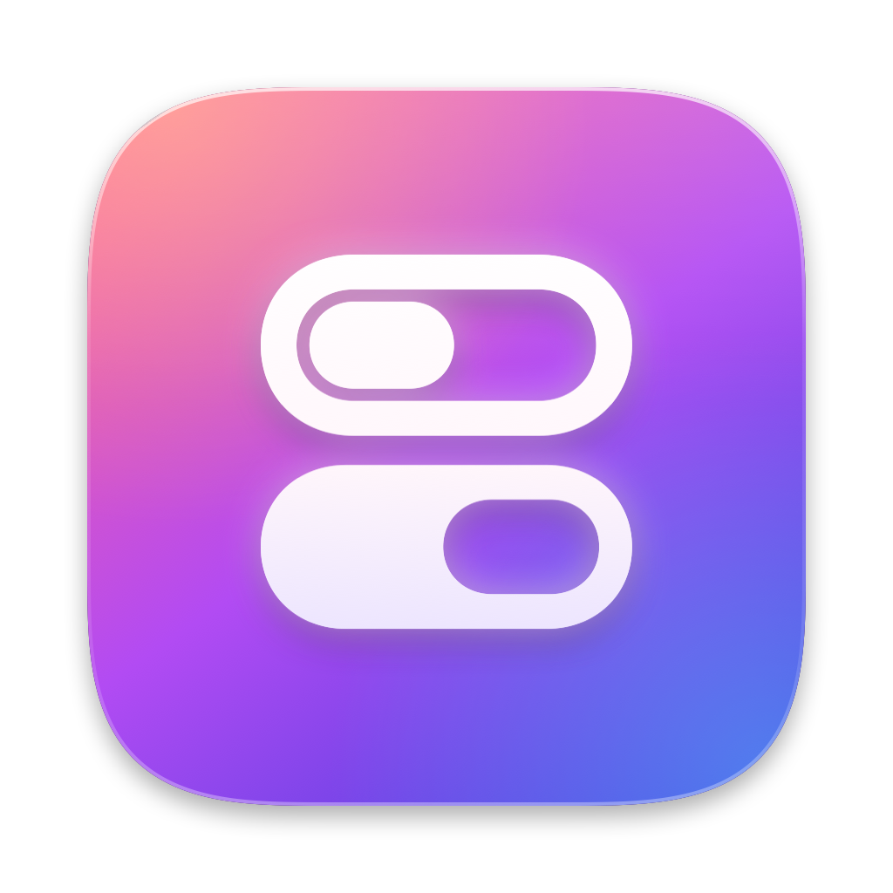
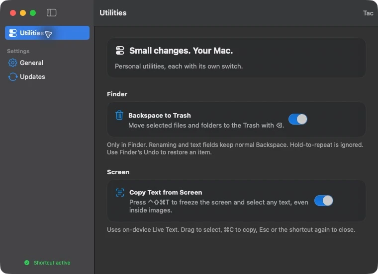
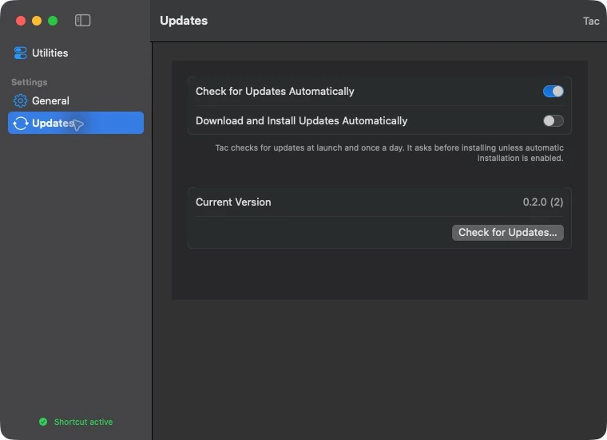

<p align="center">
  
</p>
<h1 align="center">Tac</h1>
<h3 align="center">Small Mac utilities, each with its own switch.</h3>
<p align="center">
  <a href="https://github.com/IGOLz/Tac/releases/latest"></a>
  
  
  <a href="LICENSE"></a>
</p>
<p align="center">
  <a href="https://github.com/IGOLz/Tac/releases/latest">Download</a> ·
  <a href="#features">Features</a> · <a href="#screenshots">Screenshots</a> · <a href="#build-from-source">Build</a> ·
  <a href="CONTRIBUTING.md">Contributing</a>
</p>

<p align="center"></p>

## Why

Tac collects small changes to everyday Mac behavior in a native menu bar app.
Turn on the utilities you want and leave the rest off.

## Install

Download the DMG from the [latest release](https://github.com/IGOLz/Tac/releases/latest),
open it and drag **Tac** into **Applications**. Release builds are universal for
Apple silicon and Intel, Developer ID signed, notarized and stapled.

Or use the [Homebrew tap](https://github.com/IGOLz/homebrew-tap):

```sh
brew install --cask igolz/tap/tac
brew upgrade --cask tac
# To remove the app:
brew uninstall --cask tac
```

Requires **macOS Sonoma 14 or later**. Utilities work on both architectures.
Intel builds are cross-compiled; runtime testing is on Apple silicon.

Grant only the permissions needed by the features you enable:

| Utility | Permission | Why |
| --- | --- | --- |
| Backspace to Trash | Accessibility | Recognize Finder focus and remap Backspace |
| Middle-Click Scroll | Accessibility | Recognize web content under the pointer and scroll it |

Open the pane from Tac's permission card.

Closing the window keeps Tac running in the menu bar. **Quit Tac** stops its
utilities. **General → Launch at login** is optional.

## Features

### Backspace to Trash

Select files or folders in Finder and press **⌫**. Tac adds Command to that event
and lets Finder handle the Trash, permissions, confirmation dialogs and **⌘Z**.

Renaming, search fields and other apps keep normal Backspace. Existing shortcuts
are unchanged. Holding the key does not repeatedly trash the next item. Unknown
Accessibility contexts are left unchanged. Tac never deletes files directly or
empties the Trash.

### Middle-Click Scroll

Click the mouse wheel on a web page to scroll like on Windows. A round marker stays
where you clicked; move the pointer above or below it and the page scrolls in that
direction, faster the farther you go. Click any button or press any key to stop
(**Esc** is not passed to the page). You can also hold the wheel, drag and release.

It starts only on empty areas of web content in Safari, Chromium browsers and web-based
apps. Anything with its own action keeps its usual middle-click: links open in a new tab,
browser tabs close, and buttons, fields, videos and elements the page handles clicks on
are left alone, as are native views. Unknown Accessibility contexts are left unchanged.

### Signed updates

Tac uses [Sparkle](https://sparkle-project.org) to check for stable releases at
launch and once a day. **Check for Updates…** is in the app and menu bar menus.
**Settings → Updates** lets you disable checks or enable automatic installation.
Automatic installation is off by default.

## Screenshots



## Privacy

No analytics, advertising, keyboard or mouse recording. Preferences stay on your Mac.

Update checks and downloads contact GitHub and its asset hosts, which receive
normal connection metadata such as your IP address. Sparkle system profiling is
disabled. You can turn off automatic update checks.

## Build from source

Install Xcode with a Swift 6 toolchain, then:

```sh
git clone https://github.com/IGOLz/Tac.git
cd Tac
swift test
scripts/build.sh
open build/Tac.app
```

The default source build is ad-hoc signed. **Do not replace an installed release
with an ad-hoc build if you want to preserve its permission identity.**
Use `SIGNING_IDENTITY="Developer ID Application: …" scripts/install.sh`
to test, build, sign and install with your certificate.

<details>
<summary>Development and release details</summary>

- Open `Package.swift` in Xcode. Sparkle is the only package dependency.
- `UNIVERSAL=1 scripts/build.sh` builds both Mac architectures.
- There is one app identity and no separate Dev application.
- `python3 Tests/HomebrewChecks.py` and `node --test Tests/ReleaseIssuesChecks.cjs`
  test release automation offline.
- [Releasing](docs/Releasing.md) covers signing, notarization, EdDSA keys,
  publishing, Homebrew and issue completion.
- [Icon source](.github/assets/make-icon.swift) generates the app's artwork.

</details>

## Contributing

See [Contributing](CONTRIBUTING.md). Use [issues](https://github.com/IGOLz/Tac/issues)
for bugs and feature ideas. Remove private content from any screenshots you attach.

## Acknowledgements

Built with SwiftUI, AppKit and the Accessibility API.
Updates use [Sparkle](https://sparkle-project.org), distributed under its
[license](https://github.com/sparkle-project/Sparkle/blob/2.x/LICENSE).

## License

[MIT](LICENSE), © 2026 Alexandru Ciprian Craciun.
