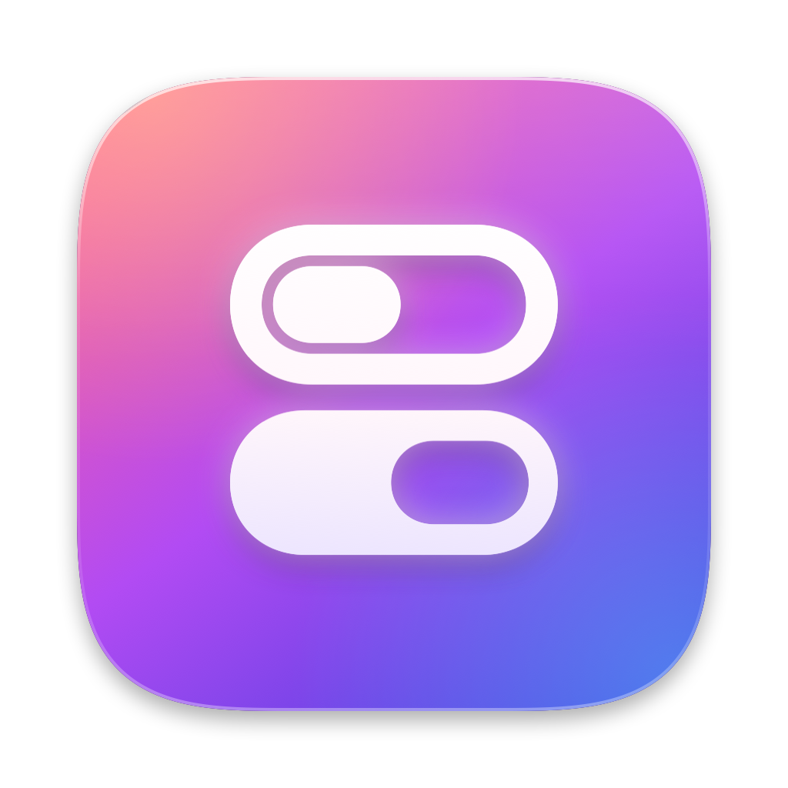
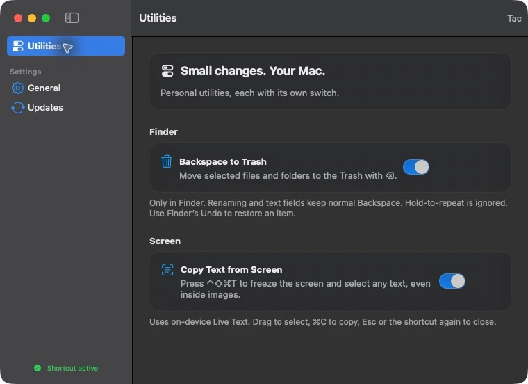
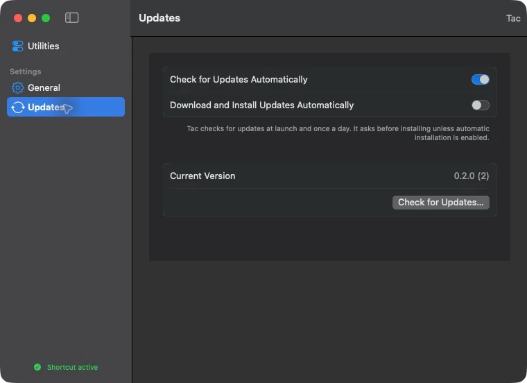

<p align="center">
  
</p>
<h1 align="center">Tac</h1>
<h3 align="center">Small Mac utilities, each with its own switch.</h3>
<p align="center">
  <a href="https://github.com/IGOLz/Tac/releases/latest"></a>
  
  
  <a href="LICENSE"></a>
</p>
<p align="center">
  <a href="https://github.com/IGOLz/Tac/releases/latest">Download</a> ·
  <a href="#features">Features</a> · <a href="#screenshots">Screenshots</a> · <a href="#build-from-source">Build</a> ·
  <a href="CONTRIBUTING.md">Contributing</a>
</p>

<p align="center"></p>

## Why

Tac collects small changes to everyday Mac behavior in a native menu bar app.
Turn on the utilities you want and leave the rest off.

## Install

Download the DMG from the [latest release](https://github.com/IGOLz/Tac/releases/latest),
open it and drag **Tac** into **Applications**. Release builds are universal for
Apple silicon and Intel, Developer ID signed, notarized and stapled.

Or use the [Homebrew tap](https://github.com/IGOLz/homebrew-tap):

```sh
brew install --cask igolz/tap/tac
brew upgrade --cask tac
# To remove the app:
brew uninstall --cask tac
```

Requires **macOS Sonoma 14 or later**. Finder shortcuts work on both architectures.
Screen text recognition uses Apple's on-device Vision framework. Recognition quality
depends on text size, language and image clarity. Intel builds are cross-compiled;
runtime testing is on Apple silicon.

Grant only the permissions needed by the features you enable:

| Utility | Permission | Why |
| --- | --- | --- |
| Backspace to Trash | Accessibility | Recognize Finder focus and remap Backspace |
| Copy Text from Screen | Screen Recording | Capture the displays for on-device text recognition |

Open these panes from Tac's permission cards. After enabling Screen Recording,
quit and reopen Tac if macOS requests it.

Closing the window keeps Tac running in the menu bar. **Quit Tac** stops its
utilities. **General → Launch at login** is optional.

## Features

### Backspace to Trash

Select files or folders in Finder and press **⌫**. Tac adds Command to that event
and lets Finder handle the Trash, permissions, confirmation dialogs and **⌘Z**.

Renaming, search fields and other apps keep normal Backspace. Existing shortcuts
are unchanged. Holding the key does not repeatedly trash the next item. Unknown
Accessibility contexts are left unchanged. Tac never deletes files directly or
empties the Trash.

### Copy Text from Screen

Press **⌃⇧⌘T** to freeze the displays and select text, including text inside images.
Text is recognized on your Mac with Apple's Vision framework. The pointer becomes an
I-beam within a few points of recognized text, and a selection can start just beside it.
Dragging selects whole words and stays in the column you start in, so a sidebar at the
same height is left out. Double-click copies a single word. Releasing the mouse copies
the selection, shows a "Text copied" chip and returns to your app. **Esc** cancels.
The same shortcut closes the overlay.

After Tac is installed or updated, macOS prepares accurate recognition once, which can
take a minute or more on some Macs. Tac starts this when it opens and shows the progress in
**Utilities → Screen → Text Recognition**; meanwhile quick recognition keeps the shortcut usable.

Change the shortcut in **Utilities → Screen → Shortcut**: click it and press a new
combination with ⌘, ⌃ or ⌥, or a function key.

### Signed updates

Tac uses [Sparkle](https://sparkle-project.org) to check for stable releases at
launch and once a day. **Check for Updates…** is in the app and menu bar menus.
**Settings → Updates** lets you disable checks or enable automatic installation.
Automatic installation is off by default.

## Screenshots



## Privacy

No analytics, advertising or keyboard recording. Preferences stay on your Mac.
Screen captures are processed locally and are not uploaded; selected text is
written to the macOS clipboard.

Update checks and downloads contact GitHub and its asset hosts, which receive
normal connection metadata such as your IP address. Sparkle system profiling is
disabled. You can turn off automatic update checks.

## Build from source

Install Xcode with a Swift 6 toolchain, then:

```sh
git clone https://github.com/IGOLz/Tac.git
cd Tac
swift test
scripts/build.sh
open build/Tac.app
```

The default source build is ad-hoc signed. **Do not replace an installed release
with an ad-hoc build if you want to preserve its permission identity.**
Use `SIGNING_IDENTITY="Developer ID Application: …" scripts/install.sh`
to test, build, sign and install with your certificate.

<details>
<summary>Development and release details</summary>

- Open `Package.swift` in Xcode. Sparkle is the only package dependency.
- `UNIVERSAL=1 scripts/build.sh` builds both Mac architectures.
- There is one app identity and no separate Dev application.
- `python3 Tests/HomebrewChecks.py` and `node --test Tests/ReleaseIssuesChecks.cjs`
  test release automation offline.
- [Releasing](docs/Releasing.md) covers signing, notarization, EdDSA keys,
  publishing, Homebrew and issue completion.
- [Icon source](.github/assets/make-icon.swift) generates the app's artwork.

</details>

## Contributing

See [Contributing](CONTRIBUTING.md). Use [issues](https://github.com/IGOLz/Tac/issues)
for bugs and feature ideas. Remove private content from any screenshots you attach.

## Acknowledgements

Built with SwiftUI, AppKit, ScreenCaptureKit and Vision.
Updates use [Sparkle](https://sparkle-project.org), distributed under its
[license](https://github.com/sparkle-project/Sparkle/blob/2.x/LICENSE).

## License

[MIT](LICENSE), © 2026 Alexandru Ciprian Craciun.
